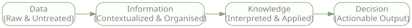
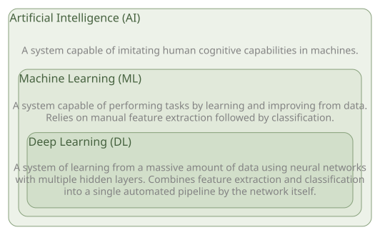
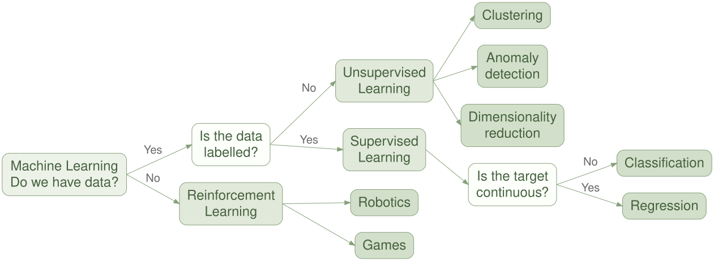
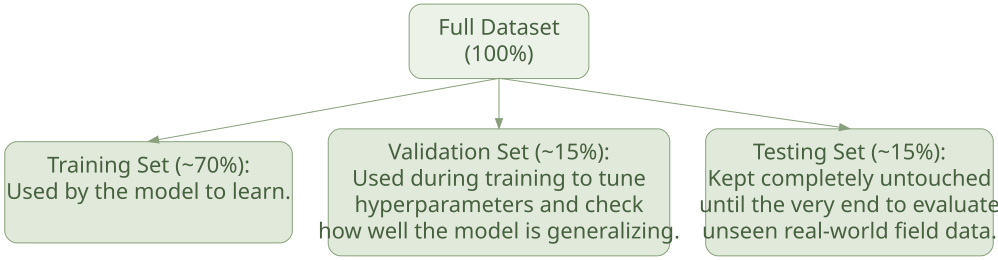
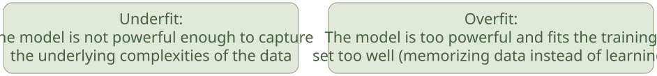
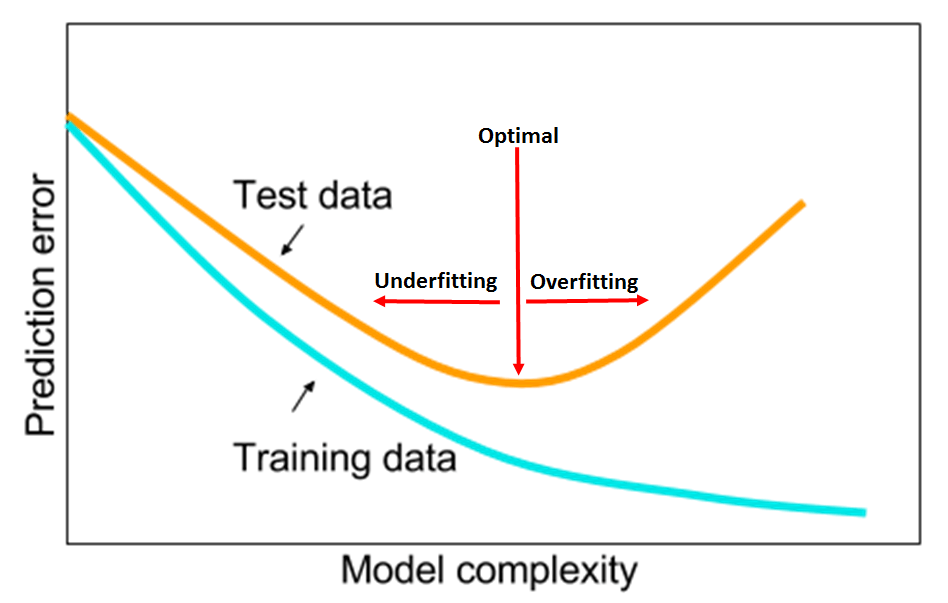
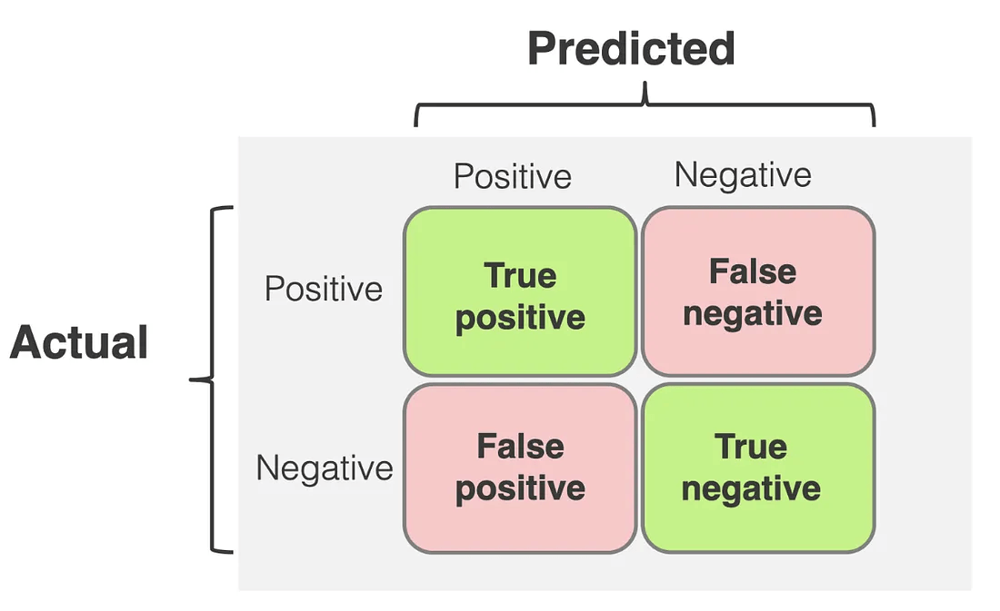
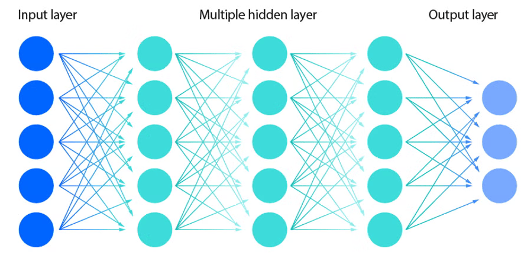
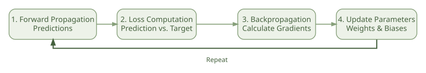
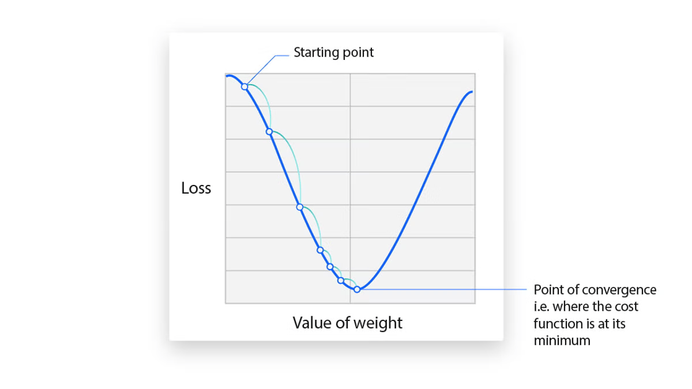

## From Data to Decisions

<div style="margin-top: 4em; margin-bottom: 4em;">
How can large volumes of biological data be translated into actionable decisions?
</div>

```{r}
#| echo: false

library(DiagrammeR)
library(DiagrammeRsvg)

data_pipeline <- grViz('
  digraph {
    rankdir = LR

    node [
      shape = box,
      style = "rounded,filled",
      fillcolor = "#fcfffa",
      color = "#87a07b",
      fontcolor = "#828282",
      fontname = "Plus Jakarta Sans"
    ]

    edge [
      color = "#87a07b"
    ]

    Data [label = "Data\\n(Raw & Untreated)"]
    Information [label = "Information\\n(Contextualized & Organised)"]
    Knowledge [label = "Knowledge\\n(Interpreted & Applied)"]
    Decision [label = "Decision\\n(Actionable Output)"]

    Data -> Information -> Knowledge -> Decision
  }
')

writeLines(export_svg(data_pipeline), "graphs/data_pipeline.svg")
```



---

## AI vs. ML vs. DL

```{r}
#| echo: false

library(DiagrammeR)
library(DiagrammeRsvg)

ai_hierarchy <- grViz('
  digraph {
    graph [rankdir = TB]
    node [
      shape = plaintext,
      fontname = "Plus Jakarta Sans",
      fontsize = 14,
      fontcolor = "#828282"
    ]

    subgraph cluster_ai {
      label = "Artificial Intelligence (AI)"
      labelloc = t
      labeljust = l
      fontname = "Plus Jakarta Sans"
      fontcolor = "#45613e"
      fontsize = 16
      style = "rounded,filled"
      color = "#87a07b"
      fillcolor = "#edf2e9"
      margin = 14

      AI_text [label = "A system capable of imitating human cognitive capabilities in machines."]

      subgraph cluster_ml {
        label = "Machine Learning (ML)"
        labelloc = t
        labeljust = l
        fontname = "Plus Jakarta Sans"
        fontcolor = "#45613e"
        fontsize = 16
        style = "rounded,filled"
        color = "#87a07b"
        fillcolor = "#e1e9da"
        margin = 12

        ML_text [label = "A system capable of performing tasks by learning and improving from data.\\nRelies on manual feature extraction followed by classification."]

        subgraph cluster_dl {
          label = "Deep Learning (DL)"
          labelloc = t
          labeljust = l
          fontname = "Plus Jakarta Sans"
          fontcolor = "#45613e"
          fontsize = 16
          style = "rounded,filled"
          color = "#87a07b"
          fillcolor = "#d2dfca"
          margin = 10

          DL_text [label = "A system of learning from a massive amount of data using neural networks\\nwith multiple hidden layers. Combines feature extraction and classification\\ninto a single automated pipeline by the network itself."]
        }
      }
    }

    AI_text -> ML_text [style = invis]
    ML_text -> DL_text [style = invis]
  }
')

writeLines(export_svg(ai_hierarchy), "graphs/ai_hierarchy.svg")
```



---

## Types of Learning

```{r}
library(DiagrammeR)
library(DiagrammeRsvg)

learning_types <- grViz('
  digraph {
    graph [
      rankdir = LR,
      splines = line,
      nodesep = 0.40,
      ranksep = 0.65
    ]

    node [
      shape = box,
      style = "rounded,filled",
      fontname = "Helvetica",
      fontsize = 24,
      fontcolor = "#45613e",
      color = "#87a07b",
      margin = "0.18,0.12"
    ]

    edge [
      color = "#87a07b",
      fontname = "Helvetica",
      fontsize = 20,
      fontcolor = "#666666",
      tailport = e,
      headport = w
    ]

    # 1. Decision nodes (light background)
    node [fillcolor = "#fcfffa"]
    ML [label = "Machine Learning\\nDo we have data?", fillcolor = "#edf2e9"]
    Q1 [label = "Is the data\\nlabelled?"]
    Q2 [label = "Is the target\\ncontinuous?"]

    # 2. Learning paradigms (medium green)
    node [fillcolor = "#e1e9da"]
    UL [label = "Unsupervised\\nLearning"]
    SL [label = "Supervised\\nLearning"]
    RL [label = "Reinforcement\\nLearning"]

    # 3. Specific tasks (darker green)
    node [fillcolor = "#d2dfca"]
    Clustering
    Anomaly        [label = "Anomaly\\ndetection"]
    DimRed         [label = "Dimensionality\\nreduction"]
    Classification
    Regression
    Robotics
    Games

    # Connections
    ML -> Q1 [label = " Yes "]
    ML -> RL [label = " No "]

    Q1 -> UL [label = " No "]
    Q1 -> SL [label = " Yes "]

    UL -> {Clustering Anomaly DimRed}

    SL -> Q2
    Q2 -> Classification [label = " No "]
    Q2 -> Regression     [label = " Yes "]

    RL -> {Robotics Games}
  }
')

writeLines(export_svg(learning_types), "graphs/learning_type.svg")
```



<div style="margin-top: 3em">
An AI model is only as good as the data it receives (garbage in - garbage out)
</div>

---

## Data Split

<div style="margin-bottom: 3em">
**Core Rule**: A model cannot be tested on the data it learned from
</div>

```{r}
library(DiagrammeR)
library(DiagrammeRsvg)

data_split <- grViz('
  digraph {
    graph [
      rankdir = TB,
      splines = line,
      nodesep = 0.50,
      ranksep = 0.70
    ]

    node [
      shape = box,
      style = "rounded,filled",
      fontname = "Plus Jakarta Sans",
      fontsize = 22,
      fontcolor = "#45613e",
      color = "#87a07b",
      margin = "0.20,0.15"
    ]

    edge [
      color = "#87a07b",
      fontname = "Plus Jakarta Sans",
      fontsize = 18,
      fontcolor = "#666666",
      tailport = s,
      headport = n
    ]

    Dataset [label = "Full Dataset\\n(100%)", width = 2.5, fillcolor = "#edf2e9"]

    # Uniform width makes all three bottom boxes perfectly balanced
    node [fillcolor = "#e1e9da", width = 4.0]
    Training   [label = "Training Set (~70%):\\nUsed by the model to learn.\\n "]
    Validation [label = "Validation Set (~15%):\\nUsed during training to tune\\nhyperparameters and check\\nhow well the model is generalizing."]
    Testing    [label = "Testing Set (~15%):\\nKept completely untouched\\nuntil the very end to evaluate\\nunseen real-world field data."]

    Dataset -> {Training Validation Testing}
  }
')

writeLines(export_svg(data_split), "graphs/data_split.svg")
```



---

## Underfitting vs. Overfitting

```{r}
library(DiagrammeR)
library(DiagrammeRsvg)

model_fit <- grViz('
  digraph {
    graph [
      rankdir = LR,
      splines = line,
      nodesep = 0.40,
      ranksep = 0.60
    ]

    node [
      shape = box,
      style = "rounded,filled",
      fontname = "Plus Jakarta Sans",
      fontsize = 22,
      fontcolor = "#45613e",
      color = "#87a07b",
      margin = "0.20,0.15"
    ]

    node [fillcolor = "#e1e9da", width = 4.2]
    Underfitting [label = "Underfitting:\\nThe model is not powerful enough to capture\\nthe underlying complexities of the data"]
    Overfitting  [label = "Overfitting:\\nThe model is too powerful and fits the training\\nset too well (memorizing data instead of learning)"]

    # Forces them onto the same horizontal row without showing a line
    Underfitting -> Overfitting [style = invis]
  }
')

writeLines(export_svg(model_fit), "graphs/model_fit.svg")
```



**Aim**: Finding the Optimal Balance

➔ Monitor validation/test error during training to tune hyperparameters

{width="50%" fig-align="center"}

---

## Evaluation Metrics

**Can we trust the model?**

Evaluation metrics based on the model  + Confusion Matrix

➔ Sums up the performance of a classification model.

{width="80%" fig-align="center"}

---

## Neural Networks

**Input Layer** (X1, X2, …,Xn): Captures raw input (variable/feature)

**Hidden Layers**

**Output layer** (Y): Produces the final prediction

{width="80%" fig-align="center"}

---

## Hidden Layers

<div style="font-size: 90%;">

Composed of artificial neurons that compute:
$$z = \sum w_i x + b$$

::: {layout="[50, 50]"}
::: {.column}
#### Weights
Multipliers attached to every input coming into a neuron (measures of how importance)
:::

::: {.column}
#### Biases
A constant value added to the weighted sum inside a neuron (thresholds of how easily a neuron is activate) 
High bias: Activates easily, even with weak inputs.
Low/Negative bias: Requires an exceptionally strong signal to activate.
:::
:::

#### Activation Functions ($a = f(z)$)
Introduction of non linearity and to allow the network to learn more complex problems.

</div>

---

## How a network “learns”

**Cost function**: difference between the predicted outputs of a model and the actual target values

**Aim**: minimize the cost function
➔ Gradient descent 

```{r}

library(DiagrammeR)
library(DiagrammeRsvg)

learning_cycle <- grViz('
  digraph {

    graph [
      rankdir = LR,
      splines = ortho,
      nodesep = 0.45,
      ranksep = 0.55,
      bgcolor = "transparent",
      pad = 0.25
    ]

    node [
      shape = box,
      style = "rounded,filled",
      fontname = "Plus Jakarta Sans",
      fontsize = 15,
      fontcolor = "#45613e",
      color = "#87a07b",
      penwidth = 1.5,
      fillcolor = "#edf2e9",
      margin = "0.22,0.16",
      width = 2.15,
      height = 0.85
    ]

    edge [
      color = "#87a07b",
      penwidth = 1.8,
      arrowsize = 0.9,
      fontname = "Plus Jakarta Sans",
      fontsize = 12,
      fontcolor = "#666666"
    ]

    Forward [
      label = "1. Forward Propagation\\nPredictions"
    ]

    Loss [
      label = "2. Loss Computation\\nPrediction vs. Target"
    ]

    Backward [
      label = "3. Backpropagation\\nCalculate Gradients"
    ]

    Update [
      label = "4. Update Parameters\\nWeights & Biases"
    ]

    Forward -> Loss -> Backward -> Update

    Update -> Forward [
      constraint = false,
      minlen = 5,
      color = "#45613e",
      penwidth = 2.2,
      arrowsize = 1.1,
      tailport = s,
      headport = s,
      label = "  Repeat",
      fontcolor = "#45613e",
      fontsize = 13
    ]
  }
')

writeLines(
  export_svg(learning_cycle),
  "graphs/learning_cycle.svg"
)

```

{width="80%" fig-align="center"}

{width="50%" fig-align="center"}

---

## Neural Network Architectures

**Convolutional Neural Networks (CNNs)**

Designed for image-based data, CNNs use convolutional filters to detect spatial patterns and hierarchical features.

*Example:* Detecting leaf rust in field images captured by drones.

**Recurrent Neural Networks (RNNs)**

Designed for sequential data, RNNs use recurrent connections to capture temporal dependencies and patterns.

*Example:* Using daily temperature and soil moisture measurements to predict crop water stress and yield.

**Transformers**

Use attention mechanisms to capture relationships across entire sequences or inputs, allowing them to model broader contextual dependencies.

*Examples:* Large Language Models (LLMs) and protein structure prediction tools such as AlphaFold.

---

## Sources & Acknowledgments {.center}

Workshop instructed by [Dr. Amal Jlassi](https://www.linkedin.com/in/amal-jlassi-phd-0b0a72140/)

NVIDIA Fundamentals of Deep Learning Course

[3Blue1Brown – Neural Networks](https://www.3blue1brown.com/?topic=neural-networks)
